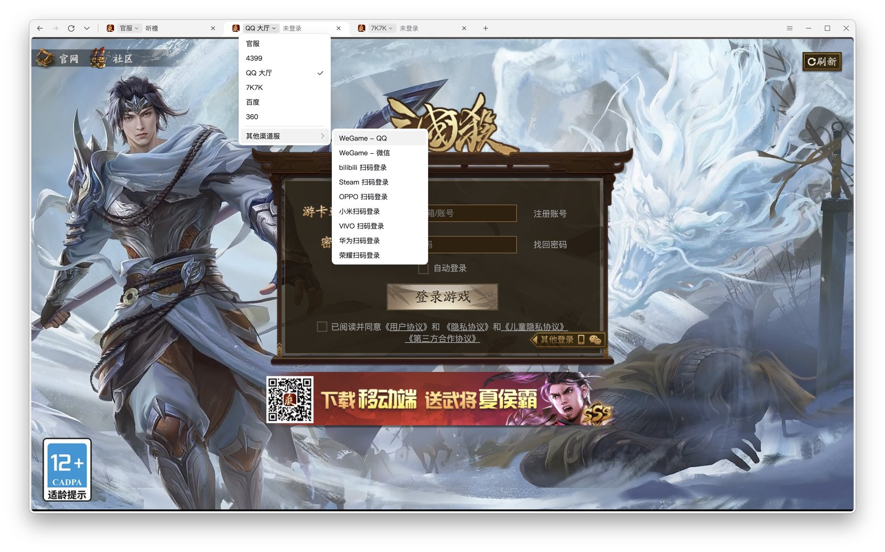

# 锦囊妙计 — 三国杀一将成名桌面客户端

 

一个窗口里开多个账号，每个标签一个隔离容器；官服和各渠道的入口、WeGame／Steam／哔哩哔哩等扫码登录都在标签上选；记住密码，重启恢复，后台更新。

渠道扫码登录支持 WeGame（QQ／微信）、bilibili、Steam、OPPO、小米、VIVO、华为与荣耀。统一登录器只保存本机可恢复的官方登录态，不保存渠道密码或验证码。



## 快速开始

玩家：到 Releases 下载安装包（整理中）。

开发者（5 分钟）：

1. 安装依赖
   ```bash
   git clone https://github.com/Clarrycy/jinnangmiaoji.git && cd jinnangmiaoji && npm install
   ```
2. 编译并运行
   ```bash
   node scripts/build-ts.js && npx electron jinnangdai
   ```
3. 跑测试
   ```bash
   for t in tests/*.test.js; do node "$t"; done
   ```

## 安装

- 系统：Windows 10 及以上，macOS 11 及以上（Apple 芯片）
- 从源码运行需要 Node.js 18 及以上
- 打包：`JND_MICRO_SEEDLESS=1 node scripts/build-portable.js jinnangdai`；macOS 加 `JND_MICRO_MAC=1` 出 DMG；Windows 安装包 `node scripts/build-setup.js jinnangdai <输出目录>`（需要 makensis）

## 使用

| 要做的事 | 操作 |
|---|---|
| 再开一个账号 | 标签条右侧 `+`，或 Ctrl+T |
| 换入口／扫码登录 | 点标签上的服名 |
| 找回关掉的账号 | 标签条左侧 ▾ 的「最近关闭」 |
| 管理保存的账号 | 右上角 ≡ → 账号，或登录页账号框下拉里的「管理账号」 |
| 检查更新 | 右上角 ≡ → 更新 |

## 示例

用独立的数据目录跑一个干净实例，不碰正式账号簿：

```bash
JND_MICRO_PROFILE=dev npx electron jinnangdai
```

打开调试端口，用 CDP 驱动验证：

```bash
npx electron jinnangdai --remote-debugging-port=9333
```

## 目录

- `src/core/` 主进程与页面桥接（TypeScript）；`core/` 是编译产物，由 `scripts/build-ts.js` 生成
- `src/core/chrome/` 标签栏、菜单、对话框引擎，与 `design/shell-harness.html` 共用同一份
- `scripts/` 编译与打包；`tests/` 单元测试

## 贡献

issue 与 PR 欢迎。界面改动先在 `design/shell-harness.html` 里看效果再落到客户端里。

## 许可证

[Apache License 2.0](LICENSE)
