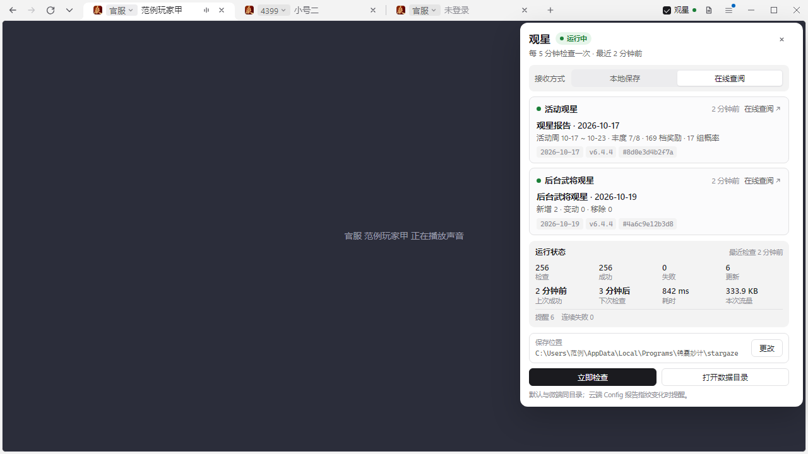
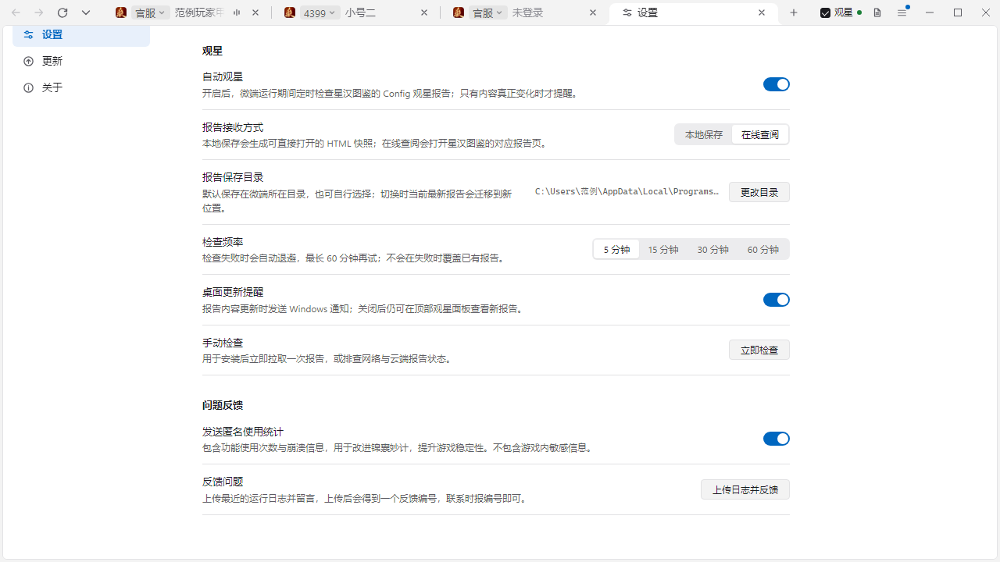

# 锦囊妙计 — 三国杀一将成名桌面客户端

 

一个窗口里开多个账号，每个标签一个隔离容器；官服和各渠道的入口、WeGame／Steam／哔哩哔哩等扫码登录都在标签上选；记住密码，重启恢复，后台更新。


## 快速开始

玩家：到 Releases 下载安装包（整理中）。

开发者（5 分钟）：

1. 安装依赖
   ```bash
   git clone https://github.com/Clarrycy/jinnangmiaoji.git && cd jinnangmiaoji && npm install
   ```
2. 编译并运行
   ```bash
   node scripts/build-ts.js && npx electron jinnangdai
   ```
3. 跑测试
   ```bash
   for t in tests/*.test.js; do node "$t"; done
   ```

## 安装

- 系统：Windows 10 及以上，macOS 11 及以上（Apple 芯片）
- 从源码运行需要 Node.js 18 及以上
- 打包：`JND_MICRO_SEEDLESS=1 node scripts/build-portable.js jinnangdai`；macOS 加 `JND_MICRO_MAC=1` 出 DMG；Windows 安装包 `node scripts/build-setup.js jinnangdai <输出目录>`（需要 makensis）

## 使用

| 要做的事 | 操作 |
|---|---|
| 再开一个账号 | 标签条右侧 `+`，或 Ctrl+T |
| 换入口／扫码登录 | 点标签上的服名 |
| 找回关掉的账号 | 标签条左侧 ▾ 的「最近关闭」 |
| 管理保存的账号 | 右上角 ≡ → 账号，或登录页账号框下拉里的「管理账号」 |
| 检查更新 | 右上角 ≡ → 更新 |

## 自动观星

标题栏右侧有 `观星` 勾选框和观星面板按钮。勾选后，微端会在运行期间定时检查星汉图鉴已经生成的公开报告，不会启动 Python 解包器，也不需要在游戏目录里额外安装组件。

| 本地保存 | 在线查阅 |
|:---:|:---:|
|  |  |



- **接收方式**：`本地保存` 会把最新报告归档为可直接打开的 HTML（同目录另存 JSON 摘要）；`在线查阅` 会打开对应报告网页。两种模式都会保留本地归档，切换后历史报告仍可复查。
- **更新提醒**：首次同步只建立基线；之后报告语义内容的 SHA-256 指纹发生变化时才提醒（忽略 Cloudflare 注入脚本和报告生成时间等外壳变化）。提醒同时出现在 Windows 通知和微端顶部提示条，点击按当前接收方式打开报告。
- **运行面板**：显示活动观星、后台武将观星的日期、版本、摘要、指纹、检查次数、成功／失败、更新与提醒次数、耗时、流量、下次检查时间和最近错误；也可手动检查、打开数据目录或更改保存位置。
- **检查频率**：可选 5／15／30／60 分钟。两类报告都检查失败时按 5 → 10 → 20 → 40 → 60 分钟退避；失败不会覆盖已有报告。
- **数据目录**：默认在微端程序同目录的 `stargaze` 文件夹；可在设置页或观星面板点击「更改」选择其他文件夹。若程序目录不可写（例如安装在 `Program Files`），会自动退回用户数据目录下的 `stargaze`，界面会显示实际路径。切换时当前最新报告会自动迁移，`reports` 中保存 `latest-<类型>.html/json` 和最近 12 份历史快照。

报告源：

- 活动观星：<https://activity.xinghantujian.top/>
- 后台武将观星：<https://generals.xinghantujian.top/>

微端只消费云端检测器产出的报告。`Config.sgs` 指纹检测、解包、报告生成以及企业微信／QQ 推送仍由云端检测项目负责；微端不保存 Webhook 密钥，也不会在本地重新实现一套检测链路。若上游报告页结构或地址变化，需要同步调整 `src/core/stargaze-report.ts` 中的报告源与解析规则。

## 示例

用独立的数据目录跑一个干净实例，不碰正式账号簿：

```bash
JND_MICRO_PROFILE=dev npx electron jinnangdai
```

打开调试端口，用 CDP 驱动验证：

```bash
npx electron jinnangdai --remote-debugging-port=9333
```

## 目录

- `src/core/` 主进程与页面桥接（TypeScript）；`core/` 是编译产物，由 `scripts/build-ts.js` 生成
- `src/core/chrome/` 标签栏、菜单、对话框引擎，与 `design/shell-harness.html` 共用同一份
- `scripts/` 编译与打包；`tests/` 单元测试

## 贡献

issue 与 PR 欢迎。界面改动先在 `design/shell-harness.html` 里看效果再落到客户端里。

## 许可证

[Apache License 2.0](LICENSE)
